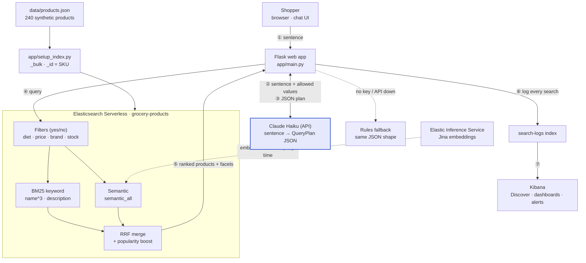
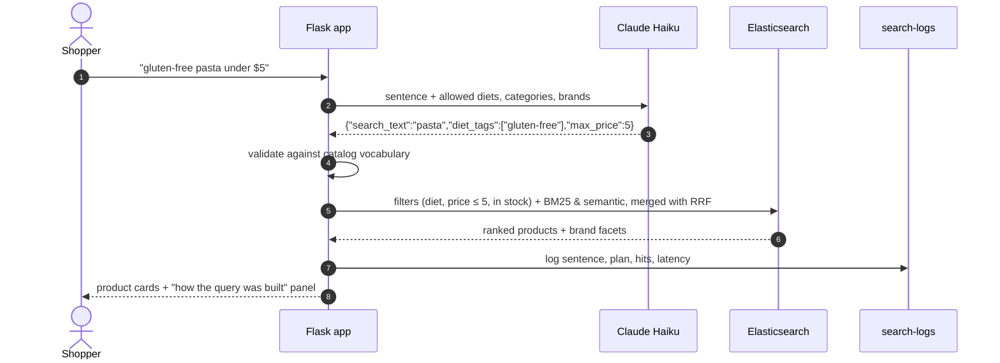
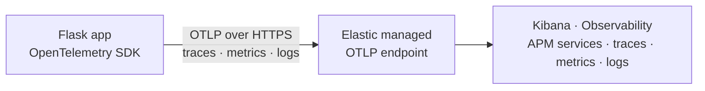

# Grocery Search Assistant

A personal rebuild of a conversational product search pattern for a national grocery retailer (2017–2019: Watson for intent/entities,
Elasticsearch for products), using today's stack. **Synthetic catalog, invented brands, no client data or code.**

## System design

Where each piece fits, including the one job Claude does:



**Where Claude fits:** only steps ②–③. It turns the shopper's sentence into a structured plan
(`search_text`, `diet_tags`, `max_price`, `brand`, …). It never sees the catalog and never ranks products;
Elasticsearch does all retrieval. The app drops any value Claude returns that isn't in the catalog vocabulary,
and a rules parser produces the same JSON when there's no API key or the API is down, so search keeps working.

### One search, step by step



### Why `_id` is the SKU

Products are loaded with `_bulk` using the SKU as the document ID. Re-running the loader **overwrites instead of
duplicating**, updates from a source database (or a Kafka/CDC stream) hit exactly the right document, and lookups
are direct: `GET grocery-products/_doc/SKU-00002`.

Why the filters live inside **both** retrievers: semantic search alone turns hard rules into "similar enough", so it
could return regular pasta for a gluten-free ask. Diet, price, brand and stock are facts, so they're filters.

## 1. Run it on your Mac against your Elastic Cloud deployment

Settings come from `.env` (see `.env.example`). Optionally, point `CREDS_FILE` at another env file with keys `ES_URL`/`ES_API_KEY` (or `API_endpoint`/`API_key`).

```bash
cd grocery-search
python3 -m venv .venv && source .venv/bin/activate
pip install -r requirements.txt
cp .env.example .env        # add ANTHROPIC_API_KEY, and KIBANA_URL (the .kb. endpoint) for the --kibana step
python -m app.setup_index --kibana        # creates index (with ELSER semantic), loads 240 products, Kibana data views
python -m app.main                        # open http://localhost:8080
```

- First load with semantic on can take a few minutes while ELSER starts; the script retries. In a hurry:
  `python -m app.setup_index --reset --no-semantic` (BM25 only, works on any license).
- No `ANTHROPIC_API_KEY`? It still works with a rule-based parser; the UI shows `understood by rules`.
- Local Docker instead of Cloud: `curl -fsSL https://elastic.co/start-local | sh` in this folder; its `.env` is read too.

Tests (no Elasticsearch or Claude needed): `python -m unittest discover -s tests -v`

## 2. Host it cheaply

| Option | Cost | Notes |
|---|---|---|
| **A. Elastic Cloud trial + app on Google Cloud Run** | $0 for 14 days, then Elastic is paid | Easiest. `gcloud run deploy grocery-search --source . --set-env-vars ES_URL=...,ES_API_KEY=...,ANTHROPIC_API_KEY=... --allow-unauthenticated`. Cloud Run free tier covers a demo. |
| **B. Everything on Kubernetes (k3s) on Oracle Cloud Always Free** | $0 ongoing | 1 Ampere VM, 2 OCPU / 12 GB. Most "real" story: ECK operator, same as customers run on EKS/GKE. Single node, so no HA. |

### Option B step by step

```bash
# On the Oracle VM (Ubuntu, Ampere A1, 2 OCPU / 12 GB). Open ports 80/443 in the VCN security list AND on the VM:
sudo iptables -I INPUT -p tcp --dport 80 -j ACCEPT && sudo netfilter-persistent save
curl -sfL https://get.k3s.io | sh -                # Kubernetes + Traefik ingress
sudo sysctl -w vm.max_map_count=262144             # Elasticsearch requirement
export KUBECONFIG=/etc/rancher/k3s/k3s.yaml

helm repo add elastic https://helm.elastic.co && helm install elastic-operator elastic/eck-operator -n elastic-system --create-namespace
kubectl apply -f k8s/trial-license.yaml            # optional: 30-day trial for ELSER + RRF
kubectl apply -f k8s/01-elastic.yaml
kubectl get elasticsearch -w                       # wait for health: green

kubectl create secret generic claude --from-literal=api-key=sk-ant-...
sed -i "s/CHANGE_ME_IP/$(curl -s ifconfig.me)/g" k8s/02-app.yaml
kubectl apply -f k8s/02-app.yaml
kubectl logs job/load-catalog -f
```

Image: build for ARM since Ampere is ARM:
`docker buildx build --platform linux/arm64 -t ghcr.io/prav10194/grocery-search:latest --push .`
(make the GHCR package public, or add an imagePullSecret). Then open `http://app.<IP>.nip.io` and `http://kibana.<IP>.nip.io`
(log in as `elastic`, password from `kubectl get secret grocery-es-elastic-user -o jsonpath='{.data.elastic}' | base64 -d`).

## Observability: the app monitors itself (OpenTelemetry → Elastic APM)

The app can send **traces, metrics and logs** about itself to Elastic using OpenTelemetry (`app/telemetry.py`).
It's off unless configured, so the app runs the same without it.



| Signal | What you get |
|---|---|
| Traces | each `POST /api/chat` as a waterfall: **understand query** (Claude call) → **search products** (Elasticsearch query) |
| Metrics | `searches` by mode and understanding source, `searches.zero_results`, `search.duration`, process CPU and memory |
| Logs | one "search done" line per search, linked to its trace |

Setup: create an **Observability** project in Elastic Cloud, open **Add data → Application → OpenTelemetry**, and put the endpoint and key in `otel.env` (git-ignored):

```
OTEL_EXPORTER_OTLP_ENDPOINT=https://<project>.ingest.<region>.elastic.cloud:443
OTEL_EXPORTER_OTLP_HEADERS=Authorization=ApiKey <key>
```

Requires Python 3.10+ for the OpenTelemetry packages. Start the app and look for `Telemetry on → …`, then open **Applications → Service inventory → grocery-search**.

### What the first traces found (and the fix)

The first trace of `POST /api/chat` showed that the actual product search was only ~15% of the request:

| Span | Before | After | Change |
|---|---|---|---|
| `anthropic.messages.create` (Claude) | 991 ms | ~1,000–1,500 ms (varies per call) | none (next target) |
| `indices.get_mapping` | 418 ms on **every** search | once per process | cached in `index_has_semantic()` |
| `search` (the product query) | 372 ms | 276 ms | none |
| `index` (write to `search-logs`) | 677 ms, inside the request | ~580 ms, **after** the response | background thread |
| Non-LLM part of the request | ~1,470 ms | ~280 ms | about 5× faster |

The log write still appears in the same trace because the background job runs inside a copy of the request's
context (`contextvars.copy_context()`). It just finishes after the response bar ends. The Claude call is now ~80%
of each request, so the next step is skipping it for one- or two-word queries that the rules parser handles.

## 3. Kibana

See [kibana/DASHBOARD.md](kibana/DASHBOARD.md): searches over time, top queries, **zero-result queries**, latency p95, diet demand.

## Files

| Path | What |
|---|---|
| `data/generate_catalog.py` | Makes `products.json`: 240 products, 12 categories, 10 stores (seeded, so it's the same every run) |
| `app/setup_index.py` | Mapping (text vs keyword, `name.keyword`, `semantic_text` via `copy_to`), bulk load with SKU as `_id`, log index, data views |
| `app/understand.py` | Claude Haiku `messages.parse` → `QueryPlan`; output cleaned against the catalog vocabulary; rule-based fallback |
| `app/search.py` | Filters + BM25 + ELSER + RRF, popularity boost, brand facet; degrades to lexical if semantic/RRF fails |
| `app/main.py` | Flask: `/`, `/api/chat`, `/api/health`; logs every search |
| `k8s/` | ECK Elasticsearch + Kibana, app Deployment, Ingress, load Job, trial license |
| `deploy/aws-eks/` | Terraform for a 3-zone AWS EKS cluster + ECK: dedicated masters, zone-aware hot nodes, failover test ([README](deploy/aws-eks/README.md)) |
