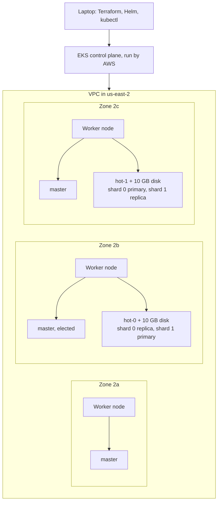

# Elasticsearch on AWS: EKS + ECK, built with Terraform

A hands-on lab: Terraform builds a Kubernetes cluster on AWS (EKS) across three availability zones,
the ECK operator runs Elasticsearch and Kibana on it, and you test failover, scaling and a rolling upgrade.

```
Terraform ──► AWS: VPC across 3 availability zones + EKS cluster + 3 worker nodes (m7i-flex.large)
                     │
Helm ───────► ECK operator (runs inside EKS)
                     │
kubectl ────► Elasticsearch "lab": 3 dedicated masters + hot data nodes, zone-aware
              Kibana "lab"  →  opened on your laptop with port-forward (no load balancer cost)
```

**Cost:** about $0.50–0.70 per hour while it runs (EKS control plane, 3 VMs, a NAT gateway, small disks).
**Always finish with step 7 (teardown).**

## What this is and why (plain version)



| Layer | What it is | Why |
|---|---|---|
| Terraform | Code that builds the AWS network and servers | Repeatable: `apply` builds it, `destroy` removes it, no clicking in the console |
| VPC across 3 zones | A private network spread over 3 separate AWS data centres | One data centre failing can't take the whole cluster down |
| EKS | Kubernetes where AWS runs the control plane | The usual way enterprises run Elastic on AWS when they self-manage it |
| ECK operator | Elastic's Kubernetes operator | You declare "3 masters, 2 hot nodes, version 9.0.0" in YAML; it creates the pods, disks, certificates and passwords, and handles upgrades |
| 3 dedicated masters, one per zone | Nodes that only manage cluster state | A majority (2 of 3) must agree, so losing one zone still leaves a quorum |
| Hot data nodes with zone awareness | Nodes that hold the documents | A primary and its replica are always in different zones, so one failure never loses both copies |

### What the failover test showed

1. Index `lab-books`: 2 primary shards, 1 replica each, 3 documents.
2. Deleted pod `lab-es-hot-0`. Health went **yellow**: the replica of shard 1 on `hot-1` was promoted to primary, and the missing replicas waited (delayed allocation, 1 minute) instead of copying data straight away.
3. `_count` still returned 3. No data was lost and search kept working.
4. Kubernetes recreated `hot-0` on the **same disk** in under a minute, the replicas re-synced, and health returned to **green**.


---

## Step 0: Tools and AWS access (once)

```bash
brew install awscli kubectl helm
brew tap hashicorp/tap && brew install hashicorp/tap/terraform
```

1. In the AWS console, **set a budget alert first**: Billing → Budgets → Create budget → "Zero spend" or a $10 monthly budget, with your email.
2. Create an IAM user for the lab (not the root account): IAM → Users → Create user `eck-lab` → attach `AdministratorAccess` → Security credentials → Create access key (CLI).
3. Configure the CLI:
   ```bash
   aws configure            # paste the key, secret; region us-east-2; output json
   aws sts get-caller-identity   # should show the eck-lab user
   ```

## Step 1: Build the infrastructure with Terraform (~15–20 min)

```bash
cd terraform
terraform init      # downloads the AWS provider and the VPC/EKS modules
terraform plan      # read it: what will be created?
terraform apply     # type yes; EKS takes 10–15 minutes
```

**What to notice in the plan:** a VPC, 3 private + 3 public subnets (one pair per zone), one NAT gateway,
the EKS cluster, its add-ons (including the EBS CSI driver for disks), and a node group of 3 m7i-flex.large.

Then connect kubectl (Terraform prints this command as `configure_kubectl`):

```bash
aws eks update-kubeconfig --region us-east-2 --name eck-lab
kubectl get nodes -L topology.kubernetes.io/zone     # 3 nodes, 3 different zones
```

## Step 2: Install the ECK operator

```bash
cd ..
kubectl apply -f k8s/00-storageclass.yaml           # default disk type: gp3

helm repo add elastic https://helm.elastic.co && helm repo update
helm install elastic-operator elastic/eck-operator -n elastic-system --create-namespace

kubectl get pods -n elastic-system                   # elastic-operator-0 Running
kubectl get crd | grep elastic                       # the new resource types ECK adds
```

## Step 3: Create Elasticsearch and Kibana

Check the newest 9.x version on elastic.co/downloads and put it in both YAML files (`spec.version`), or keep 9.0.0.

```bash
kubectl apply -f k8s/01-elasticsearch.yaml
kubectl get elasticsearch -w          # wait for HEALTH green, PHASE Ready (3–5 min); Ctrl+C
kubectl get pods -o wide              # which worker node each pod landed on
kubectl get pvc                       # one EBS disk per Elasticsearch pod

kubectl apply -f k8s/02-kibana.yaml
kubectl get kibana -w                 # wait for green
```

Get the password for the built-in `elastic` user and open both locally:

```bash
PW=$(kubectl get secret lab-es-elastic-user -o go-template='{{.data.elastic | base64decode}}')
echo $PW

kubectl port-forward svc/lab-es-http 9200 &      # Elasticsearch on https://localhost:9200
kubectl port-forward svc/lab-kb-http 5601 &      # Kibana on https://localhost:5601 (accept the self-signed cert)

curl -sk -u "elastic:$PW" "https://localhost:9200/_cat/nodes?v&h=name,node.role,master,heap.percent"
```

**What to notice:** 3 nodes with role `m` (one marked `*` = elected master) and 2 with `dis` (data_hot, data_content, ingest).
ECK created the certificates, the `elastic` user and the Kibana connection for you.

## Step 4: See zone awareness

```bash
# a small helper so you don't retype the URL and password (works in zsh and bash)
es() { curl -sk -u "elastic:$PW" "https://localhost:9200$1" "${@:2}"; }

es "/_cat/nodeattrs?v&h=node,attr,value" | grep zone        # each node knows its zone

es "/lab-books" -X PUT -H 'Content-Type: application/json' \
  -d '{"settings":{"number_of_shards":2,"number_of_replicas":1}}'
es "/_cat/shards/lab-books?v&h=index,shard,prirep,state,node"
```

**What to notice:** each primary (`p`) and its replica (`r`) are on hot nodes in **different zones**
(allocation awareness on the `zone` attribute). Losing a whole zone can't take both copies.

## Step 5: Experiments

**1. Kill a data node (failover)**
```bash
kubectl delete pod lab-es-hot-0
es "/_cluster/health?pretty"        # yellow: replicas promoted, one copy missing
kubectl get pods -w                  # the StatefulSet recreates the pod with the same disk
es "/_cluster/health?pretty"        # back to green
```

**2. Kill a master (quorum)**
```bash
kubectl delete pod lab-es-masters-0
es "/_cat/nodes?v&h=name,master"     # another master is elected; the cluster keeps working
```

**3. Look at what ECK manages**
```bash
kubectl get statefulsets             # one per nodeSet: lab-es-masters, lab-es-hot
kubectl get svc                      # lab-es-http, lab-kb-http, internal transport
kubectl get secrets | grep lab       # certificates and users
```

**4. Scale the hot tier 2 → 3**
Edit `k8s/01-elasticsearch.yaml`, set the hot `count: 3`, then:
```bash
kubectl apply -f k8s/01-elasticsearch.yaml
kubectl get pods -w
es "/_cat/shards/lab-books?v&h=shard,prirep,node"   # shards rebalance onto the new node
```

**5. Rolling upgrade**
Change `spec.version` in both YAML files to a newer 9.x patch (e.g. 9.0.0 → 9.0.1), then:
```bash
kubectl apply -f k8s/01-elasticsearch.yaml -f k8s/02-kibana.yaml
kubectl get pods -w                  # pods restart one at a time; health stays yellow/green, never red
es "/"                               # new version number
```

**6. Kibana**
Log in at https://localhost:5601 as `elastic`. Open Dev Tools and run Lab 1–5 queries from the study site,
and Stack Monitoring to see the nodes. Unlike your Serverless trial, `_cat/shards` and `_cat/nodes` work here.

## Step 6: What to say in an interview

> "I built an Elasticsearch cluster on AWS EKS with Terraform and ECK: a VPC across three availability zones,
> a managed node group, and the ECK operator. The cluster has three dedicated masters and hot data nodes,
> spread across zones with topology spread constraints, and shard allocation awareness on the zone attribute,
> so a primary and its replica never share a zone. I tested failover by deleting pods, scaled the data tier,
> and did a rolling upgrade, all through the Elasticsearch custom resource."

On OpenShift the same ECK resources apply; the differences are installing the operator from OperatorHub,
Routes instead of port-forward or load balancers, and OpenShift's security context constraints.

## Step 7: Teardown (always)

Kubernetes created the EBS disks, so delete them **before** Terraform destroys the cluster,
or they keep costing money.

```bash
kill %1 %2 2>/dev/null                         # stop the port-forwards
kubectl delete -f k8s/02-kibana.yaml -f k8s/01-elasticsearch.yaml
kubectl delete pvc --all                       # deletes the EBS volumes
helm uninstall elastic-operator -n elastic-system

cd terraform && terraform destroy              # type yes; ~10–15 minutes
```

Finally, check the console: EC2 → Volumes (no `eck-lab` volumes left) and EC2 → Load Balancers (none).
